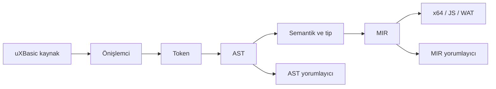

# uXBasic Beşinci Cilt

## Uygulamalı Büyük Projeler ve Sürüm Mühendisliği

Bu cilt, ilk dört ciltte ayrı ayrı incelenen dil özelliklerini iki uygulamada
birleştirir. Amaç yalnız uzun program yazmak değildir. Bir uXBasic projesinin
gereksinimden kaynak koda, kaynak koddan AST/MIR yürütmesine, x64 veya web
artifact'ına ve doğrulanmış dağıtım paketine nasıl götürüldüğünü göstermektir.

İlk proje, Windows üzerinde yorumlayıcı ve native hedefleri olan bir kargo
operasyon çekirdeğidir. İkinci proje, aynı sayısal iş kuralını JavaScript/Canvas
ve WAT/WASM hedeflerine taşıyan hibrit bir panodur.

Çalıştırılabilir kaynaklar:

- `docs/uxbasic_5_cilt/examples/projects/kargo_merkezi`
- `docs/uxbasic_5_cilt/examples/projects/hibrit_pano`

Komutlar bu ciltte `uxb` dizini çalışma dizini kabul edilerek yazılmıştır.

---

# Birinci Kısım - Proje ve Sürüm Disiplini

## 1. Bir program ne zaman çalışıyor sayılır?

Derleyicinin sıfır çıkış kodu vermesi tek başına çalışma kanıtı değildir.
Özellikle çok hedefli bir derleyicide her aşamanın farklı doğrulama kanıtı
vardır.

| Aşama | Asgari kanıt |
|---|---|
| Önişlemci | Dönüştürülmüş kaynak oluşur; `%%` komutları beklenen biçimde çözülür. |
| Lexer | Token JSON oluşur, ayrıştırılır ve kaynak konumları geçerlidir. |
| Parser/AST | AST JSON oluşur, ayrıştırılır ve beklenen düğümler vardır. |
| Semantik | Tip ve sembol raporu oluşur; hata tanıları doğru çıkış koduna bağlıdır. |
| MIR | MIR JSON/CFG oluşur; verifier başarı verir. |
| AST yorumlayıcı | `ASSERT` geçer ve ayırt edici çıktı görülür. |
| MIR yorumlayıcı | AST ile aynı gözlenebilir sonucu verir. |
| x64 | ASM'yi uXBasic üretir; NASM/link sonucu gerçek EXE çalışır. |
| JavaScript | Üretilen JS gerçek bir JS motorunda çalışır. |
| Browser | HTML, uygulama JS'i ve runtime oluşur; DOM/Canvas çağrıları doğrulanır. |
| WAT | WAT ayrıştırılabilir ve beklenen export'u içerir. |
| WASM | Binary modül gerçek WebAssembly motorunda örneklenir ve export çağrılır. |

Bir test yalnız `PASS` metni basıyorsa ama sonucu hesaplamıyorsa sahtedir.
Örneğin WASM testi, kaynak dosyanın adını görüp başarı veremez. `.wasm`
dosyasını okumalı, modülü örneklemeli, export'u bulmalı ve gerçek dönüş değerini
karşılaştırmalıdır.

## 2. Proje dizini

Önerilen proje düzeni:

```text
proje/
  src/
    main.uxb
    model.uxm
  include/
    proje.uxmh
  native/
    yardimci.c
    yardimci.cpp
    yardimci.asm
  tests/
    positive/
    negative/
  config/
    build_ast.uxcli
    build_mir.uxcli
    build_x64.uxcli
  reports/
  dist/
```

`.bas`, `.uxb` ve `.uxm` derlenebilir kaynak uzantılarıdır. `.uxmh` başlık
dosyasıdır. `.uxcli`, komut satırı argümanlarını tutan yanıt dosyasıdır.
`.uxm` uzantısı yalnız manifest anlamına indirgenmez; mevcut derleme zinciri
onu kaynak olarak da kabul eder.

## 3. `.uxcli` yanıt dosyası

Kaynakta `src/cli/cli_response_file.fbs`, `@dosya.uxcli` argümanını okur.
Dosya boşluklarla ayrılmış CLI token'ları içerir. Çift tırnak boşluklu yolu
tek token yapar. `#` karakterinden satır sonuna kadar olan bölüm yorumdur.
Yanıt dosyaları sekiz düzeye kadar iç içe açılabilir.

Örnek:

```text
# Kargo merkezini AST yorumlayıcıda çalıştır
int
docs/uxbasic_5_cilt/examples/projects/kargo_merkezi/main.uxb
--execmem
--interpreter-backend
AST
```

Çalıştırma:

```powershell
.\bin\uxb.exe @docs\uxbasic_5_cilt\examples\projects\kargo_merkezi\ast.uxcli
```

Yanıt dosyası kabuk script'i değildir. Bir dosyada art arda bağımsız iki
derleyici süreci tanımlamaz; tek bir uXBasic çağrısının argümanlarını taşır.
Birden çok hedef için PowerShell/BAT koşucusu ayrı süreçler başlatmalıdır.

## 4. Derleme kimliği ve artifact kökü

Tekrarlanabilir koşuda her çalışmaya bir kimlik verilir:

```powershell
.\bin\uxb.exe ast .\kaynak.uxb `
  --run-id kitap_ast_001 `
  --out-root .\reports
```

`--run-id`, farklı koşuların aynı dosyaları ezmesini önler. `--out-root`
merkezi çıktı köküdür; `--artifact-root` geriye uyumlu eş addır. Açık
`--ast-json-out`, `--wat-out` veya `--emit-x64-nasm-out` verildiğinde test,
özellikle o dosyayı denetlemelidir.

## 5. Pozitif ve negatif test

Pozitif test doğru programın gerçek sonucunu doğrular:

```text
ASSERT UcretHesapla(8, 220) = 105
PRINT "KARGO_MERKEZI_PASS"
```

Negatif test yanlış programın doğru yerde reddedilmesini doğrular:

```text
DIM dar AS U8
dar = 300
```

Negatif testte beklenen:

1. sıfır olmayan çıkış kodu;
2. doğru katman tanısı;
3. kaynak satırı veya sembol adı;
4. istenmişse geçerli tanı JSON'u;
5. sonraki backend artifact'ının oluşmaması.

Derleyici hata verip yine de bozuk EXE/WASM bırakıyorsa test geçmez.

## 6. Diferansiyel test

AST ve MIR aynı dil sözleşmesini farklı yürütme motorlarıyla uygular.
Bu nedenle ortak programlarda:

```text
AST stdout = MIR stdout
AST exit   = MIR exit
AST dosya  = MIR dosya
```

karşılaştırması yapılır. Hata metinlerinin sözcük sözcük aynı olması şart
değildir; hata sınıfı, kaynak yeri ve reddetme kararı aynı olmalıdır.

Native, JS ve WASM hedeflerinde çıktı biçimi değişebilir. Bu hedeflerde iş
sonucu ve yan etkiler karşılaştırılır.

---

# İkinci Kısım - Büyük Proje I: Kargo Operasyon Merkezi

## 7. Gereksinimler

Uygulama:

- gönderi modelini tutacak;
- ağırlık, uzaklık ve öncelikten ücret hesaplayacak;
- sınıf metodu ile risk puanı üretecek;
- gönderi kodunu özyinelemeli denetleyecek;
- `LIST`, `DICT` ve `SET` ile operasyon durumunu tutacak;
- `|>` ile risk sınırlandırma işlevine bağlanacak;
- `PIPE`, `SLOT` ve `TRIGGER` görev yüzeyini kullanacak;
- dosyaya rapor yazacak;
- AST ve MIR yorumlayıcıda aynı sonucu verecek;
- x64 üretiminde ASM'yi uXBasic derleyicisi oluşturacak.

Proje aşamalı geliştirilir. Her aşama tek başına çalışır; son `main.uxb`
özellikleri birleştirir.

## 8. Aşama 1: veri modeli ve saf iş kuralı

Kaynak:
`examples/projects/kargo_merkezi/01_model_ve_kural.uxb`

```text
TYPE Gonderi
    kod AS I32
    agirlik AS I32
    uzaklik AS I32
    oncelik AS U8
END TYPE

FUNCTION UcretHesapla(
    BYVAL agirlik AS I32,
    BYVAL uzaklik AS I32,
    BYVAL oncelik AS U8
) AS I32
    DIM sonuc AS I32
    sonuc = 30 + agirlik * 8 + uzaklik \ 20
    IF oncelik = U8(1) THEN
        sonuc = sonuc + 25
    END IF
    RETURN sonuc
END FUNCTION
```

`U8(1)` açık dönüşümdür. uXBasic'te `U8` bir tanımlama sözcüğü olduğu gibi,
tip dönüştürme çağrısı olarak da kullanılabilir. `\` tamsayı bölmesidir; `/`
F64 bölmesi üretir. Ücret hesabında küsurat istenmediği için `\` seçilmiştir.

Model testi:

```text
g.kod = 7001
g.agirlik = 6
g.uzaklik = 180
g.oncelik = U8(1)
ucret = UcretHesapla(g.agirlik, g.uzaklik, g.oncelik)
ASSERT ucret = 112
```

Çalıştırma:

```powershell
.\bin\uxb.exe int `
  docs\uxbasic_5_cilt\examples\projects\kargo_merkezi\01_model_ve_kural.uxb `
  --execmem --interpreter-backend AST
```

Beklenen ayırt edici satırlar:

```text
MODEL_KOD=7001
MODEL_UCRET=112
KARGO_ASAMA1_PASS
```

MIR için yalnız backend değeri değiştirilir:

```powershell
.\bin\uxb.exe int `
  docs\uxbasic_5_cilt\examples\projects\kargo_merkezi\01_model_ve_kural.uxb `
  --execmem --interpreter-backend MIR
```

## 9. Aşama 2A: nesne yönelimli kural

Kaynak:
`examples/projects/kargo_merkezi/02_oop_ve_rekursiyon.uxb`

```text
CLASS GonderiKurali
PUBLIC
    METHOD Hesapla(BYVAL agirlik AS I32) AS I32
        RETURN 40 + agirlik * 5
    END METHOD
END CLASS
```

Nesne:

```text
DIM kural AS GonderiKurali
kural = NEW GonderiKurali()
risk = kural.Hesapla(9)
ASSERT risk = 85
```

Metot bildirimi `METHOD ... END METHOD` biçimindedir. `SUB ... END SUB`,
`FUNCTION ... END FUNCTION` ve `MAGIC ... END MAGIC` kendi kapanış
sözcüklerini kullanır. `MAGIC ... END METHOD` bu dilin sözleşmesi değildir.

Bu aşama, sınıf yerleşimi ile çağrı çözümlemesini birlikte sınar:

- sınıf adı semantik sembol tablosuna girer;
- `NEW` nesne oluşturur;
- `kural.Hesapla` alıcı tipinden metoda çözülür;
- argüman ve dönüş tipi bağlanır;
- AST/MIR çağrı çerçevesi `SELF` durumunu korur.

## 10. Aşama 2B: özyinelemeli denetim

Kaynak:
`examples/projects/kargo_merkezi/02b_rekursif_kod_kontrolu.uxb`

```text
FUNCTION BasamakToplami(BYVAL deger AS I32) AS I32
    IF deger < 10 THEN
        RETURN deger
    END IF
    RETURN (deger MOD 10) + BasamakToplami(deger \ 10)
END FUNCTION
```

Özyinelemenin üç zorunlu parçası vardır:

1. `deger < 10` taban durumu;
2. `deger \ 10` ile küçülen problem;
3. alt çağrının sonucunu kullanan dönüş.

Test:

```text
ASSERT BasamakToplami(7308) = 18
```

Bu küçük kaynak, fonksiyonun kendi sembolüne gövde içinden bağlanmasını ve her
çağrıda ayrı yerel değer çerçevesi açılmasını sınar.

## 11. Aşama 3: koleksiyon ve iki pipe yüzeyi

Kaynak:
`examples/projects/kargo_merkezi/03_koleksiyon_ve_pipe.uxb`

Koleksiyonlar:

```text
DIM bekleyen AS LIST
DIM durum AS DICT
DIM bolge AS SET

CALL LISTADD(bekleyen, 7308)
CALL DICTSET(durum, "7308", 1)
CALL SETADD(bolge, "IC_ANADOLU")
```

Koleksiyon tutacağı ile öğe tipi aynı şey değildir. Çekirdek koleksiyonlar
dinamik değer taşır. Mutasyon çağrıları tutacağı günceller. Boyut işlevleri
tamsayı sonuç üretmelidir:

```text
DIM adet AS I32
adet = LISTLEN(bekleyen)
ASSERT adet = 1
```

`|>` ifade operatörü:

```text
risk = 137 |> RiskSinirla
```

`PIPE ... END PIPE` görev bildirimi:

```text
PIPE RiskSinirla puan AS I32
    IF puan > 100 THEN
        OUTPUT = 100
    ELSE
        OUTPUT = puan
    END IF
END PIPE

SLOT
    RiskSlot 12 ON PIPE RiskSinirla
END SLOT
```

Bu iki yüzey benzer veri akışı fikrini paylaşır fakat aynı sözdizimsel yapı
değildir. `|>` bir ifadedir ve sonucu sağ taraftaki çağrı zincirine taşır.
`PIPE` ise `SLOT`, `TRIGGER`, `ON/OFF`, olay ve görev runtime'ıyla ilişkili
bildirimdir.

Tetikleme:

```text
TRIGGER RiskSinirla, 64
ASSERT OUTPUT = 64
```

Bir test yalnız `TRIGGER` satırının parse edilmesini değil, `OUTPUT` değerinin
gerçekten 64 olmasını denetler.

## 12. Aşama 4: dosya raporu

Kaynak:
`examples/projects/kargo_merkezi/04_dosya_raporu.uxb`

```text
OPEN "docs/uxbasic_5_cilt/examples/projects/kargo_merkezi/operasyon_raporu.txt" _
    FOR OUTPUT AS #17
PRINT #17, "7401"
PRINT #17, "2"
CLOSE #17
```

Okuma:

```text
OPEN "docs/uxbasic_5_cilt/examples/projects/kargo_merkezi/operasyon_raporu.txt" _
    FOR INPUT AS #18
INPUT #18, kod
INPUT #18, durum
CLOSE #18
```

`#17` ve `#18` tip son eki değildir; dosya kanalı numarasıdır. Kanal sabit
sayı veya uygun değişken olabilir. Her `INPUT #` çağrısı bu örnekte bir
hedef okur. Okunan değerler `I32` değişkenlere dönüştürülür:

```text
ASSERT kod = 7401
ASSERT durum = 2
```

Dosya testi yalnız konsol çıktısını denetlemez. Dosyanın varlığını, tam
satırlarını ve tekrar okunan değerleri de karşılaştırır.

## 13. Birleşik program

Kaynak:
`examples/projects/kargo_merkezi/main.uxb`

Birleşik program:

- Önişlemci A ile taban ücreti tanımlar.
- `TYPE Gonderi` kullanır.
- `CLASS AgirlikKurali` nesnesini oluşturur.
- özyinelemeli kod kontrolü yapar.
- `LIST`, `DICT`, `SET` tutar.
- `|>` ve `PIPE` görevini birlikte kullanır.
- sonuç raporunu dosyaya yazar.

Önişlemci sabiti:

```text
%%PP A
%%DEFINE TABAN_UCRET 30
```

İş kuralları:

```text
ucret = UcretHesapla(g.agirlik, g.uzaklik)
risk = (kural.AgirlikPuani(g.agirlik) + 81) |> RiskSinirla
```

Doğrulama:

```text
ASSERT adet = 1
ASSERT ucret = 105
ASSERT risk = 100
ASSERT BasamakToplami(g.kod) = 18
```

Beklenen rapor:

```text
7506
105
100
```

Programın `KARGO_MERKEZI_PASS` yazması ancak dört `ASSERT` ve dosya
doğrulaması da geçtiğinde anlamlıdır.

## 14. AST ve MIR proje kapısı

PowerShell örneği:

```powershell
$source = "docs\uxbasic_5_cilt\examples\projects\kargo_merkezi\main.uxb"

.\bin\uxb.exe int $source --execmem --interpreter-backend AST
if ($LASTEXITCODE -ne 0) { throw "AST yürütme başarısız" }

.\bin\uxb.exe int $source --execmem --interpreter-backend MIR
if ($LASTEXITCODE -ne 0) { throw "MIR yürütme başarısız" }
```

Profesyonel koşucu iki stdout akışını ayrı dosyalara alır ve normalize edilmiş
çıktıları karşılaştırır. Programın ürettiği rapor da her backend sonrasında
okunur.

## 15. x64 ASM üretimi

ASM test dosyasını dışarıdan yazmak yalnız backend'i izole denemek için
kullanılabilir. Proje kapısında asıl ASM, uXBasic derleyicisi tarafından
üretilir:

```powershell
.\bin\uxb.exe x64 `
  docs\uxbasic_5_cilt\examples\projects\kargo_merkezi\main.uxb `
  --emit-x64-nasm `
  --emit-x64-nasm-out reports\kargo\main.asm
```

Doğrulama:

1. `main.asm` komuttan önce yoktur veya ayrı run dizinindedir.
2. Komut sıfır çıkış kodu verir.
3. Dosya oluşur ve sıfır bayt değildir.
4. `global`, kod bölümü ve program sembolleri bulunur.
5. Dosya NASM tarafından assemble edilir.
6. Linker gerçek EXE üretir.
7. EXE'nin stdout ve rapor dosyası yorumlayıcı sonucu ile karşılaştırılır.

Hazır bir `.asm` dosyasının varlığı uXBasic x64 backend başarısı sayılamaz.

## 16. Proje için negatif testler

Önerilen negatif aile:

| Vaka | Beklenen katman |
|---|---|
| Bilinmeyen `Gonderi` alanı | Semantik |
| `U8` alana 300 atama | Tip/dönüşüm |
| Eksik `END METHOD` | Parser |
| Olmayan sınıf metodu | Semantik |
| Taban durumsuz recursion | Runtime limit veya statik politika |
| Kapalı dosya kanalına `INPUT #` | Runtime |
| Olmayan `PIPE` için `TRIGGER` | Semantik/runtime |
| `LISTLEN` sonucunu uyumsuz tipe atama | Semantik |
| Native hedefte browser-only `SCREEN` | Backend |

Negatif test, derleyicinin çökmesini beklemez. Kontrollü tanı ve belirli çıkış
kodu bekler.

---

# Üçüncü Kısım - Büyük Proje II: Hibrit Operasyon Panosu

## 17. Hedef ayrımı

Hibrit proje tek kaynağı zorla her hedefte çalıştırmaz. Paylaşılan sayısal
çekirdek ile hedefe özgü sunum ayrılır:

| Dosya | Rol | Hedef |
|---|---|---|
| `01_skor_cekirdegi.uxb` | Sayısal iş kuralı ve konsol testi | AST/MIR |
| `01b_wasm_skor_modulu.uxm` | String içermeyen export modülü | WAT/WASM |
| `02_canvas_pano.uxb` | Canvas çizimi | Browser |
| `main.uxb` | Sayısal kural + pano | Browser |
| `browser_verify.js` | Üretilen Canvas çağrılarını sınar | Node.js |
| `wasm_verify.js` | Gerçek WASM export'unu çağırır | Node.js |

Bu ayrım eksiklik gizlemek için yapılmaz. WAT backend string linear-memory
lowering'i uygulamıyorsa `"TESLIM_SKOR="` gibi string kullanan kaynak için
sahte sıfır handle üretmek yerine derleme reddedilir. Sayısal modül ise gerçek
WAT/WASM üretir.

## 18. Paylaşılan skor çekirdeği

```text
FUNCTION TESLIMSKOR(
    BYVAL teslim AS I32,
    BYVAL gecikme AS I32,
    BYVAL hasar AS I32
) AS I32
    RETURN teslim * 10 - gecikme * 3 - hasar * 7
END FUNCTION
```

Örnek:

```text
skor = TESLIMSKOR(18, 4, 2)
ASSERT skor = 154
```

Formül:

```text
18 * 10 - 4 * 3 - 2 * 7
= 180 - 12 - 14
= 154
```

AST ve MIR çıktısı 154 olmalıdır.

## 19. Canvas pano

Kaynak:
`examples/projects/hibrit_pano/02_canvas_pano.uxb`

```text
CALL SCREEN(960, 540)
CLS
CALL FILLRECT(24, 24, 912, 72)
CALL TEXT(48, 68, "uXBasic Kargo Operasyon Panosu")
```

`SCREEN`, `FILLRECT` ve `TEXT` bu kullanımda browser backend runtime'ına
lower edilir. AST yorumlayıcıda desteklenmiyorsa bu kaynak için açık
“unsupported” tanısı doğru davranıştır. Sessizce hiçbir şey yapıp
`HIBRIT_ASAMA2_PASS` yazmak doğru değildir.

## 20. Browser artifact üretimi

Örnek komut:

```powershell
.\bin\uxb.exe jsw `
  docs\uxbasic_5_cilt\examples\projects\hibrit_pano\main.uxb `
  --emit-browser `
  --js-out reports\hibrit_browser\app.js `
  --js-runtime-out reports\hibrit_browser\ux_runtime.js `
  --html-out reports\hibrit_browser\index.html `
  --manifest-out reports\hibrit_browser\manifest.json
```

Asgari artifact seti:

```text
reports/hibrit_browser/
  index.html
  app.js
  ux_runtime.js
  manifest.json
```

Kontroller:

- HTML, runtime'ı uygulama JS'inden önce yükler.
- Manifest geçerli JSON'dur.
- `app.js`, skor hesabını ve Canvas çağrılarını içerir.
- Dosyalar yalnız yorum veya boş şablon değildir.
- Üretilen program gerçek JS motorunda yüklenir.

## 21. Browser test düzeneği

`browser_verify.js`, uXBasic programının kendisi değildir. Üretilen JavaScript
için kontrollü bir test ortamıdır. Sahte DOM yalnız Canvas çağrılarını kaydeder;
başarı kararı şu gerçek gözlemlere bağlıdır:

- canvas genişliği 960;
- canvas yüksekliği 540;
- başlık doğru koordinata yazılmış;
- en az dört dikdörtgen çizilmiş.

Çalıştırma:

```powershell
node `
  docs\uxbasic_5_cilt\examples\projects\hibrit_pano\browser_verify.js `
  reports\hibrit_browser\app.js
```

Beklenen:

```text
HIBRIT_BROWSER_PASS
```

`app.js` yolu verilmezse veya çizimlerden biri eksikse koşucu sıfır olmayan
kodla çıkar.

## 22. WAT üretimi

String içermeyen modül:
`examples/projects/hibrit_pano/01b_wasm_skor_modulu.uxm`

```powershell
.\bin\uxb.exe wat `
  docs\uxbasic_5_cilt\examples\projects\hibrit_pano\01b_wasm_skor_modulu.uxm `
  --emit-wat `
  --wat-out reports\hibrit_wasm\skor.wat
```

WAT kontrolü:

- `(module` vardır;
- `TESLIMSKOR` için işlev/export vardır;
- parametreler ve sonuç `i32` ile uyumludur;
- sabit 154 yazan bir şablon yerine argümanlarla aritmetik yapılır;
- dosya `wat2wasm` tarafından kabul edilir.

## 23. WASM üretimi ve gerçek çağrı

```powershell
.\bin\uxb.exe wat `
  docs\uxbasic_5_cilt\examples\projects\hibrit_pano\01b_wasm_skor_modulu.uxm `
  --emit-wat --emit-wasm `
  --wat-out reports\hibrit_wasm\skor.wat `
  --wasm-out reports\hibrit_wasm\skor.wasm `
  --wat2wasm
```

Binary yalnız varlık ve boyutla doğrulanmaz:

```powershell
node `
  docs\uxbasic_5_cilt\examples\projects\hibrit_pano\wasm_verify.js `
  reports\hibrit_wasm\skor.wasm
```

Koşucu:

1. dosyayı binary okur;
2. `WebAssembly.instantiate` çağırır;
3. `TESLIMSKOR` export'unu bulur;
4. `fn(18, 4, 2)` çağırır;
5. sonucu 154 ile karşılaştırır.

Beklenen:

```text
HIBRIT_WASM_PASS
```

Bu test, uXBasic'in ürettiği WASM makine kodunun gerçekten çalıştığını
kanıtlar.

## 24. WAT string negatif kapısı

`examples/cilt3/02_wasm_skoru.uxb` string çıktı içerir. String lowering
uygulanmadığı sürece WAT backend şu sınıfta hata vermelidir:

```text
WAT string linear-memory lowering is not implemented
```

Doğru negatif test:

```powershell
.\bin\uxb.exe wat `
  docs\uxbasic_5_cilt\examples\cilt3\02_wasm_skoru.uxb `
  --emit-wat --wat-out reports\negative\string_fail.wat

if ($LASTEXITCODE -eq 0) {
    throw "String WAT desteği yokken komut başarı vermemeliydi"
}
if (Test-Path reports\negative\string_fail.wat) {
    throw "Reddedilen derleme geçerli artifact bırakmamalı"
}
```

Bu davranış bir placeholder değildir. Desteklenmeyen özelliğin sahte kod
üretmeden, açık tanıyla kapanmasıdır.

---

# Dördüncü Kısım - Gözlenebilir Derleyici Hattı

## 25. Kaynaktan artifact'a kanıt zinciri

Bir kaynak için şu zincir kurulabilir:



Her okun bir artifact veya çalışma raporu olmalıdır. Bir aşamanın raporu
istenmişse ama dosya oluşmamışsa, komut sıfır dönse bile kapı başarısızdır.

## 26. JSON doğrulaması

JSON testi:

```powershell
$json = Get-Content -Raw reports\kargo\ast.json | ConvertFrom-Json
if ($null -eq $json) { throw "AST JSON ayrıştırılamadı" }
```

Ek kontroller:

- dosya sıfır bayt değil;
- UTF-8 veya belgelenmiş encoding;
- kaynak yolu doğru;
- `status`, `schema` veya rapor türünün zorunlu alanları var;
- düğüm/simge listesi boş şablon değil;
- hata varsa exit code ve JSON durumu çelişmiyor.

İstenen `--semantic-json-out` dosyasını hiç yazmayan komut başarılı kabul
edilemez. Çözüm, testten dosya kontrolünü kaldırmak değil; CLI seçeneğini gerçek
semantik yazıcıya bağlamaktır.

## 27. Log ilkesi

Log:

- tanı için yeterli bağlam taşır;
- kullanıcı programının stdout'u ile karışmaz;
- hata kodu, katman ve kaynak konumu içerir;
- gizli anahtar veya FFI argümanı sızdırmaz;
- bir run kimliğine bağlıdır;
- başarısızlığın üstünü `PASS` satırıyla örtmez.

`--quiet`, yalnız normal logları azaltır; hata ve sıfır olmayan çıkış kodunu
yok etmez. `--trace` etkinse hook ve katman geçişleri gerçek olay üretmelidir.
Çağrılan fakat hiçbir gözlenebilir etkisi olmayan global no-op hook,
izlenebilirlik sözleşmesi sayılmaz.

## 28. Süre ölçümü

Derleyici build'i beş-altı dakika sürebilir. Bu yüzden geliştirme döngüsü iki
katmana ayrılır:

1. Kaynak değişikliğinden önce mevcut `bin/uxb.exe` ile hata yeniden üretilir.
2. Dar FreeBASIC modülü ve ilgili test hazırlanır.
3. Tam `build_64.bat` bir kez çalıştırılır.
4. Önce odak testleri koşulur.
5. Odak testler geçince geniş matris koşulur.

`--time-passes` ve `--layer-timing-json-out` süreyi aşama bazında ölçmek için
kullanılır. Ölçülmeden yapılan performans yorumu sürüm kararı değildir.

## 29. EXE büyüklüğü

Büyük derleyici EXE'sinin olası nedenleri:

- tek çeviri biriminde çok sayıda `#include once`;
- statik bağlanan runtime ve backend kodu;
- debug sembolleri;
- farklı hedeflerin aynı binary'de toplanması;
- kullanılmayan yordamların linker tarafından atılamaması;
- gömülü tablo, şablon veya kaynak metinleri;
- FreeBASIC debug/profil seçenekleri;
- PDB ve ara dosyaların dağıtım paketine yanlışlıkla alınması.

İnceleme:

```powershell
Get-Item .\bin\uxb.exe | Select-Object Length
Get-ChildItem .\diff -Recurse -Filter *.pdb |
  Select-Object FullName, Length
```

PDB'nin büyük olması derleyici EXE'sinin mantıksal olarak büyük olduğu
anlamına gelmez. EXE, PDB, OBJ ve rapor boyutları ayrı ölçülmelidir.

Boyut azaltmak için işlev silinmez. Önce release/debug build bayrakları,
linker dead-code elimination, modüler runtime DLL'leri ve paket manifesti
incelenir.

## 30. Sessiz hata sınıfları

| Sınıf | Örnek | Kapı |
|---|---|---|
| Artifact yok | `--semantic-json-out` başarı ama dosya yok | Varlık + JSON parse |
| Yanlış değer | String `INPUT #` yerine 0 | `ASSERT` + dosya karşılaştırma |
| Yanlış tip | `LISTLEN` sonucu `OBJECT` | Semantik tip testi |
| Sahte backend | Her program için aynı ASM/WAT | Sembol ve gerçek çalışma |
| Sessiz noop | `SCREEN` çağrısı hiçbir şey yapmıyor | Canvas çağrı kaydı |
| Eksik dispatch | `MAGIC HASH` var ama `obj.HASH()` çözülemiyor | AST/MIR/x64 test |
| Politika sızıntısı | FFI deny raporlanıyor ama enforce edilmiyor | Report/enforce ayrı test |
| Yanlış PASS | Koşucu yalnız exit code okuyor | Çıktı/artifact/yan etki |
| Sonsuz döngü | MIR blok sayacı ilerlemiyor | Zaman aşımı + blok izi |

## 31. Hata sınıflandırma sırası

Bir örnek başarısız olduğunda:

1. Önişlemci sonrası kaynağı incele.
2. Token ve parser tanısını incele.
3. AST'de beklenen düğümü bul.
4. Semantik sembol ve tipi kontrol et.
5. MIR opcode/CFG'yi incele.
6. AST ve MIR runtime sonuçlarını ayır.
7. Backend çıktısını gözle.
8. Native/web runtime bağımlılıklarını doğrula.

Üst katmana yama yapmak, alt katmandaki yanlış sözleşmeyi gizlememelidir.
Örneğin `LISTLEN` runtime'da doğru tamsayı döndürürken semantik katman onu
`OBJECT` biliyorsa çözüm örnek değişkenini `OBJECT` yapmak değildir. Builtin
tip registry'si düzeltilmelidir.

## 32. Regresyon testi tasarımı

Her düzeltilen hata için:

- en küçük yeniden üretici;
- doğru program için pozitif test;
- sınır/yanlış kullanım için negatif test;
- etkilenen AST ve MIR koşuları;
- backend etkileniyorsa artifact testi;
- hata geçmişi ve beklenen davranış

eklenir.

Test adı davranışı söyler:

```text
collection_listlen_returns_i32.bas
magic_hash_dispatch_ast_mir.bas
file_input_string_roundtrip.bas
semantic_json_is_materialized.bas
class_and_recursive_function_coexist.bas
```

---

# Beşinci Kısım - Native, FFI ve Güvenlik Kapıları

## 33. INLINE sözleşmesi

Geçerli başlık dört alandır:

```text
INLINE(
    "x64",
    "nasm",
    "sub",
    "abi=win64;preserve=rbx,rsi,rdi,r12,r13,r14,r15;stack=16;shadow=32"
)
    ; kod
END INLINE
```

Alanlar:

1. mimari;
2. assembler;
3. parça türü;
4. ABI/politika.

Bu sözleşme proje kitabında farklı bir dört alanlı tasarımla değiştirilmez.
C, C++ ve dış ASM kaynakları:

```text
IMPORT(C, "native/bolge_kodu.c")
IMPORT(CPP, "native/agirlik_katsayisi.cpp")
IMPORT(ASM, "native/koli_topla.asm")
```

ile build planına eklenir.

## 34. FFI allowlist

`CALL(DLL, ...)` veya `CALL(API, ...)` yolu gerçek DLL/API çağrısı üretir.
FFI testi iki politika modunda yürütülmelidir:

| Mod | Beklenen |
|---|---|
| report-only | Karar loglanır; çağrı yapılandırılmış politikaya göre devam edebilir. |
| enforce | İzin verilmeyen DLL/export sıfır olmayan kodla reddedilir. |

Kernel32 çağrısı varsayılan allowlist'te yoksa report-only uyarısı başarı
kanıtı değildir. Test, kullanılan allowlist dosyasını, modu, karar kaydını ve
gerçek dönüş değerini raporlamalıdır.

## 35. ABI ve veri yerleşimi

Windows x64 kapısında:

- ilk dört uygun argüman register'ları;
- shadow space;
- 16 bayt stack hizası;
- volatile/nonvolatile register'lar;
- string pointer yaşam süresi;
- BYVAL/BYREF farkı;
- `TYPE` alan offset ve padding;
- I8/U8/I16/U16 işaret genişletme;
- F32/F64 register sınıfı;
- ABI10 üst sınırı

kontrol edilir.

F80, F128, BIGI, BIGF, BIGD ve BALL gibi genişletilmiş tipler dış runtime ile
çalışıyorsa kullanıcı EXE'si gerekli DLL'i ve sürüm uyumunu paketlemelidir.
F8/F16 genel dil tipi kabul edilmez.

## 36. SHELL güvenliği

`SHELL` gerçek işletim sistemi süreci başlatır. Test:

- komutun çıkış kodunu;
- stdout/stderr yönlendirmesini;
- zaman aşımını;
- bulunamayan executable tanısını;
- tırnaklı yol ve argümanları

doğrular.

Kullanıcı girdisini doğrudan kabuk komutuna birleştirmek güvenli değildir.
Mümkün olduğunda sabit executable ve ayrı argüman sözleşmesi kullanılır.

## 37. PEEK, POKE ve pointer

uXBasic, gerçek belleği `PEEK`/`POKE`, pointer aritmetiği ve BYREF ile
erişilebilir kılar. Bu güç runtime tarafından sahte diziye yönlendirilmemelidir.
Ancak geçersiz adresin güvenliği kullanıcı sorumluluğundadır.

Testler yalnız kontrollü ayrılmış tamponlarda çalışır:

1. runtime veya native yardımcıyla bellek ayır;
2. boyutu bil;
3. sınır içi yaz/oku;
4. BYVAL/BYREF farkını doğrula;
5. belleği serbest bırak;
6. sınır dışı negatif testini izole süreçte yürüt.

---

# Altıncı Kısım - Standart Kütüphane ve Veri Kapıları

## 38. Kütüphane matrisi

Aktif standart modüller `include/modules`, `libsx` ve `runtime_ext` zinciriyle
doğrulanır. Bir header adı tek başına çalışma kanıtı değildir.

Her modül için matris:

| Kanıt | Soru |
|---|---|
| Header | Kullanıcı yüzeyi bildiriliyor mu? |
| Wrapper | FreeBASIC çağrı gövdesi gerçek export'a gidiyor mu? |
| Runtime | DLL kaynak ve build script'i var mı? |
| Export | Ad ve ABI header ile aynı mı? |
| Allowlist | Çağrı politikada kayıtlı mı? |
| Pozitif test | Gerçek hesap sonucu var mı? |
| Negatif test | Yanlış handle/argüman reddediliyor mu? |
| Yaşam döngüsü | `Open/Create` karşılığı `Close/Free` var mı? |

Aktif kaynakta bulunan aileler arasında matematik, matris, tensör, istatistik,
graf, veri kümesi, DuckDB dataframe, Python, ONNX, sinir ağı ve llama
runtime'ları vardır. Eski belgede geçen Lua veya Prolog adı, aktif wrapper ve
runtime yoksa dağıtılabilir standart modül olarak yazılamaz.

## 39. DuckDB dataframe

uXBasic `uxdataframe`, DuckDB tabanlı çalışma zamanıdır. Proje:

1. dataframe runtime'ını açar;
2. CSV/JSON veya sorgu kaynağını yükler;
3. filtre/projection/group/join işlemini DuckDB'ye iletir;
4. hata metnini okur;
5. handle'ları kapatır.

Test, yalnız SQL metninin parse edilmesini değil gerçek satır sayısını ve
hücre değerini karşılaştırır.

## 40. Python dataframe

Python köprüsü ayrı runtime'dır:

```text
PythonOpen
PythonAddPath
PythonImport
PythonCallModule
PythonJson
PythonRelease
PythonClose
```

Python `pandas.DataFrame`, Python nesnesidir. uXBasic çekirdek `LIST/DICT/SET`
ve DuckDB dataframe tutacağıyla gizlice aynı tipe çevrilmez. Sınırda açık JSON,
buffer veya belgelenmiş native handle protokolü kullanılır.

## 41. Kaynak paketi testi

Dağıtım paketi temiz dizinde denenir:

```text
dist/
  uygulama.exe
  runtime/
    gerekli.dll
  config/
    ffi_allowlist.txt
  data/
  LICENSES/
  manifest.json
  hashes.txt
```

Geliştirici makinesinin PATH'i geçici olarak temizlenir. Paket dışındaki bir
DLL yanlışlıkla yükleniyorsa test başarısızdır.

---

# Yedinci Kısım - Sürüm Mühendisliği

## 42. Sürüm kapısı

Dağıtılabilir sürüm için kapı:

1. FreeBASIC derleyici build'i başarılı.
2. Derleyici EXE sürüm komutu çalışıyor.
3. Kaynak envanteri ve placeholder taraması tamam.
4. Pozitif lexer/parser/semantik testleri geçiyor.
5. Negatif testler doğru tanıyla reddediliyor.
6. AST ve MIR beklenen testleri geçiyor.
7. MIR verifier ve sonsuz döngü koruması geçiyor.
8. x64 ASM üretimi uXBasic tarafından yapılıyor.
9. NASM/link/EXE gerçek çalışma testleri geçiyor.
10. JS/browser artifact ve çalışma testleri geçiyor.
11. WAT/WASM üretim ve gerçek export testleri geçiyor.
12. Preprocessor A/B matrisi geçiyor.
13. FFI report-only ve enforce testleri geçiyor.
14. Standart kütüphane DLL probe'ları geçiyor.
15. Doküman örnek koşucusu geçiyor.
16. JSON/log artifact'ları ayrıştırılıyor.
17. Dağıtım paketi temiz ortamda çalışıyor.

Bir madde koşulluysa rapor koşulu açıkça yazar. Örneğin gerçek model dosyası
gerektiren llama testi `SKIP` olabilir; fakat bu durum genel “tüm
kütüphaneler geçti” sayısına PASS olarak eklenmez.

## 43. Placeholder taraması

Arama:

```powershell
rg -n -i `
  "placeholder|stub|noop|no-op|nop|todo|to:do|pass" `
  src libsx runtime_ext include
```

Her eşleşme hata değildir. Örneğin bir tanı metni “placeholder yasak” diyebilir.
Bu nedenle sonuçlar sınıflandırılır:

| Sınıf | Eylem |
|---|---|
| Gerçek boş gövde | Uygula veya yüzeyden kaldır |
| Fail-close tanı | Koru, negatif testle |
| Yorum/tarih | Güncelle veya gerekçelendir |
| CPU `nop` talimatı | Mimari gerekçe ve test |
| Testte yasak sözcük | Tarama dışında bırak veya sınıflandır |

Kullanıcıya açık bir özellik gerçek işi yapmıyorsa adını değiştirmek çözüm
değildir. `stub` yerine `compatibility adapter` yazmak boş davranışı gerçek
yapmaz.

## 44. Build ve test sırası

Önerilen günlük sıra:

```powershell
# 1. Derleyiciyi kur
.\build_64.bat

# 2. En küçük regresyonlar
.\bin\uxb.exe int .\tests\regression\ornek.bas `
  --execmem --interpreter-backend AST
.\bin\uxb.exe int .\tests\regression\ornek.bas `
  --execmem --interpreter-backend MIR

# 3. Kitap örnekleri
.\docs\uxbasic_5_cilt\run_book_examples.ps1

# 4. Beklenen AST/MIR matrisleri
python .\xtestx\_runners\run_expected_ast_mir.py

# 5. Proje paketleri
python .\xtestx\_runners\run_xtestx_project_packs.py `
  --root . --tests xtestx --uxb .\bin\uxb.exe
```

Koşucu adları kaynak ağacında değişmişse gerçek `_runners` envanteri esas
alınır; belge körlemesine eski script adını çalıştırmaz.

## 45. Uzun build'de çalışma yöntemi

Tam build pahalıysa:

- aynı değişiklik grubu için bir kez build et;
- kaynak düzenlemeden önce tüm odak testlerini hazırla;
- build sürerken başka derleyici binary'sini ezme;
- build logunu dosyaya al;
- timeout'u gerçek beş-altı dakikalık süreye göre ayarla;
- bitmeden sonucu raporlama;
- bitince EXE zaman damgası ve boyutunu kaydet;
- yeni EXE'nin çalıştığını `ver` ile doğrula.

Eski `bin/uxb.exe` ile yeni kaynak test edilip “düzeltme geçti” denemez.

## 46. Git ve büyük dosyalar

PDB ve build artifact'ları kaynak sürümüne karıştırılmamalıdır:

```gitignore
*.pdb
*.obj
*.o
*.asm
*.exe
reports/
_work/
```

Ancak mevcut çalışma ağacında kullanıcıya ait dosyalar otomatik silinmez.
Git 100 MB sınırını aşan PDB, kaynak değişikliğini geri almaya gerekçe
değildir. Önce izlenen dosya envanteri, `.gitignore` ve dağıtım politikası
ayrılır.

## 47. Sürüm raporu

Rapor şu alanları taşır:

```json
{
  "schema": "uxbasic.release.v1",
  "compilerVersion": "1.06",
  "build": {
    "status": "pass",
    "durationMs": 0,
    "exeBytes": 0
  },
  "tests": {
    "passed": 0,
    "failed": 0,
    "skipped": 0
  },
  "targets": {
    "ast": "pass",
    "mir": "pass",
    "x64": "pass",
    "browser": "pass",
    "wasm": "pass"
  },
  "artifacts": []
}
```

Buradaki sıfırlar şablon açıklamasıdır; gerçek rapor koşucu tarafından ölçülen
değerlerle yazılır. Üretim raporunda ölçülmemiş alan 0 ile başarı gibi
gösterilmez; `null`, `not_run` veya açık erişim sorunu kullanılır.

## 48. Başarısızlık raporu

Başarısız test kaydı:

```json
{
  "id": "file_input_string_roundtrip_ast",
  "status": "fail",
  "exitCode": 0,
  "expected": "FILE",
  "actual": "0",
  "classification": "silent_wrong_value",
  "layer": "ast_runtime",
  "artifacts": [
    "reports/run/file_input_string_roundtrip_ast.stdout.txt"
  ]
}
```

Exit code 0 iken yanlış değer görülmesi özellikle yüksek önceliklidir.

## 49. Takım iş akışı

Özellik geliştiren kişi:

1. dil sözleşmesini yazar;
2. parser/AST düğümünü belirler;
3. semantik tip ve sembol davranışını tanımlar;
4. AST runtime'ı uygular;
5. MIR lowering/runtime'ı uygular;
6. x64/web hedef etkisini belirler;
7. pozitif/negatif test ekler;
8. dokümanı kaynakla günceller.

İnceleyen kişi, yalnız parser yamasına bakmaz. Özelliğin tüm uygulanabilir
katmanlarda aynı sözü verdiğini kontrol eder.

## 50. Bitmişlik tanımı

uXBasic özelliği şu koşullarda bitmiştir:

- belgelenmiş sözdizimi kaynakla aynı;
- parser gerçek AST üretir;
- semantik hatalı programı reddeder;
- tip sonucu doğru registry'den gelir;
- AST ve MIR ortak davranışta uyuşur;
- hedef backend gerçek kod üretir veya desteklenmeyeni açıkça reddeder;
- dış runtime gerçek işi yapar;
- artifact ve log seçenekleri gerçekten dosya yazar;
- pozitif ve negatif testler sonucu doğrular;
- örnek program derlenip çalıştırılmıştır;
- placeholder, stub veya sessiz no-op yoktur.

---

# Sekizinci Kısım - İleri Çalışmalar

## 51. Kargo projesini büyütme

Okuyucu aşağıdaki genişletmeleri ayrı testlerle ekleyebilir:

- gönderi durumunu `ENUM` yapmak;
- CSV'den DuckDB dataframe yüklemek;
- bölge grafını `uxgraph` ile rota ağına çevirmek;
- Python modelinden gecikme olasılığı almak;
- `EVENT` ile yeni gönderi olayını yayınlamak;
- `THREAD` ve `PARALEL` görevlerini slotlara bağlamak;
- Windows API ile servis durumu sorgulamak;
- x64 EXE ve runtime DLL'lerini paketlemek.

Her genişletme önce küçük kaynakta doğrulanır, sonra birleşik `main.uxb`
programına alınır.

## 52. Hibrit panoyu büyütme

Sonraki adımlar:

- skor verisini JSON yerine lineer WASM belleğiyle taşımak;
- string lowering'i gerçek alloc/length ABI ile uygulamak;
- Canvas olaylarını `ON` ve `EVENT` görevlerine bağlamak;
- aynı sayısal modülü browser JS ile WASM arasında karşılaştırmak;
- browser manifestine artifact hash'leri eklemek;
- headless tarayıcıyla piksel ve metin doğrulaması yapmak.

WAT string desteğinde kabul edilebilir çözüm, sahte null pointer değildir.
Bellek ayırma, UTF-8 kodlama, uzunluk, sahiplik ve serbest bırakma sözleşmesi
birlikte tasarlanmalıdır.

## 53. Derleyici geliştiricisi için okuma haritası

Bir örnek hata verdiğinde kaynak sırası:

| Soru | Kaynak ailesi |
|---|---|
| Sözcük tanınıyor mu? | `src/lexer` |
| Bildirim/komut parse ediliyor mu? | `src/parser` |
| AST düğümü doğru mu? | `src/ast` |
| Tip ve sembol doğru mu? | `src/semantic`, `src/type_binding` |
| Yerleşim/ABI doğru mu? | `src/layout`, `src/semantic` |
| MIR döngüsü/çağrısı doğru mu? | `src/mir`, `src/runtime/mir*` |
| AST çalışma sonucu doğru mu? | `src/runtime/exec` |
| ASM uXBasic tarafından doğru mu? | `src/backend/x64*`, `src/codegen` |
| JS/Canvas doğru mu? | `src/backend/js*`, browser runtime |
| WAT/WASM doğru mu? | `src/backend/wat*`, wasm runtime |
| DLL gerçekten çağrılıyor mu? | `libsx`, `runtime_ext`, FFI bridge |
| CLI dosyayı gerçekten yazıyor mu? | `src/cli`, pipeline artifact writers |

## 54. Son kontrol listesi

- İki proje kaynak ağacından mı çalıştırıldı?
- AST ve MIR sonuçları karşılaştırıldı mı?
- `LISTLEN` gibi builtin dönüş tipleri doğru mu?
- OOP ve recursion aynı programda birlikte test edildi mi?
- `MAGIC ... END MAGIC` gerçek dispatch yaptı mı?
- Metin ve sayı `INPUT #` round-trip testleri geçti mi?
- `--semantic-json-out` gerçekten JSON yazdı mı?
- x64 ASM'yi uXBasic mi üretti?
- Native EXE gerçek çalışma sonucu verdi mi?
- Browser Canvas çağrıları gerçek üretilen JS'ten gözlendi mi?
- WASM export'u gerçek motor tarafından çağrıldı mı?
- WAT string eksikliği fail-close mu?
- FFI allowlist modu raporda mı?
- Standart kütüphane probe'ları gerçek sonuç üretti mi?
- Koşullu model/veri testleri PASS sayısına katılmadı mı?
- PDB ve build artifact'ları kaynak paketinden ayrıldı mı?
- Kitap örnek koşucusu geçerli JSON raporu üretti mi?

Bu listenin tamamı kanıtlanmadan “hatasız ve eksiksiz dağıtım sürümü”
ifadesi kullanılmaz. Eksik kalan kapı açıkça raporlanır ve kaynakta
düzeltilir.
